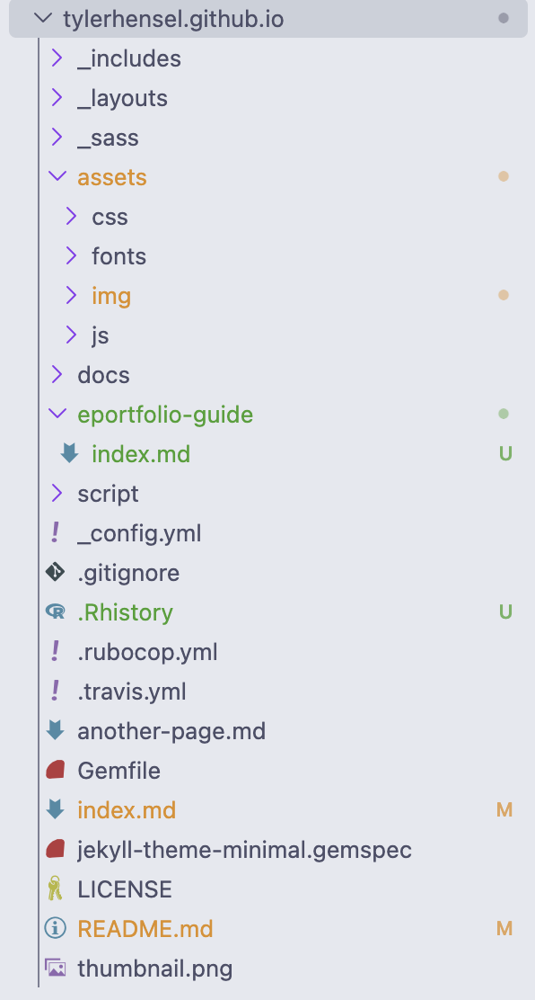
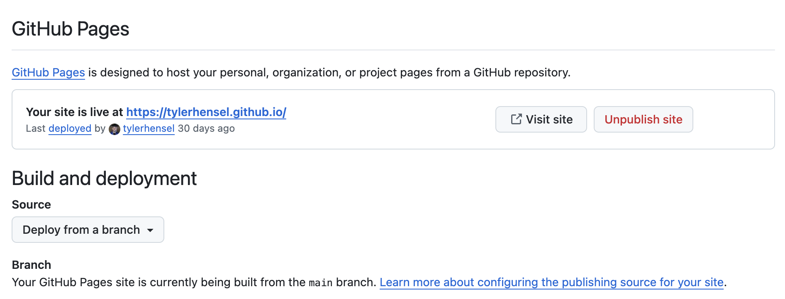
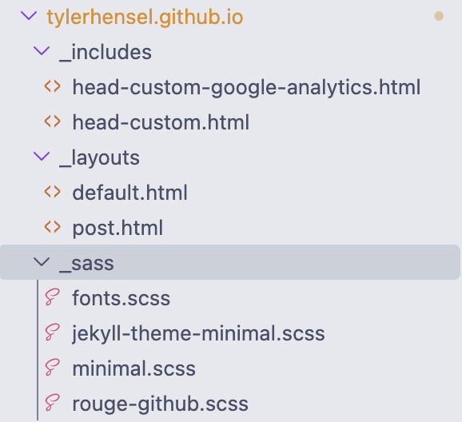
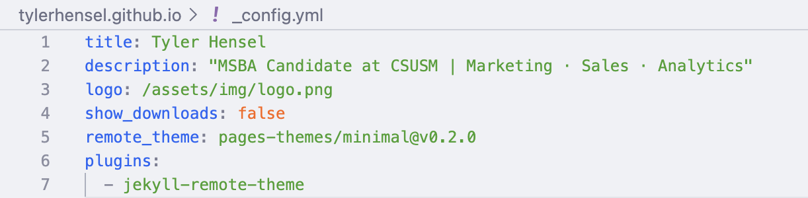
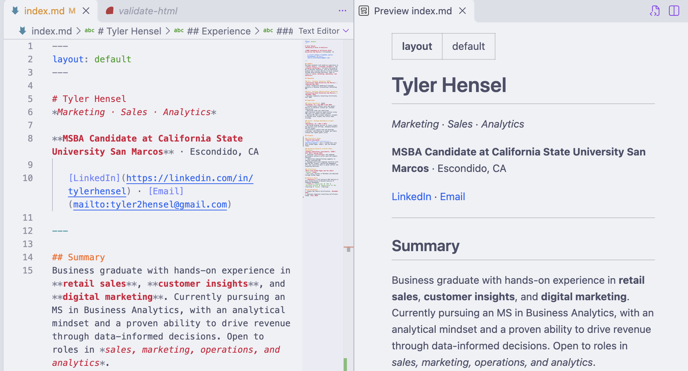
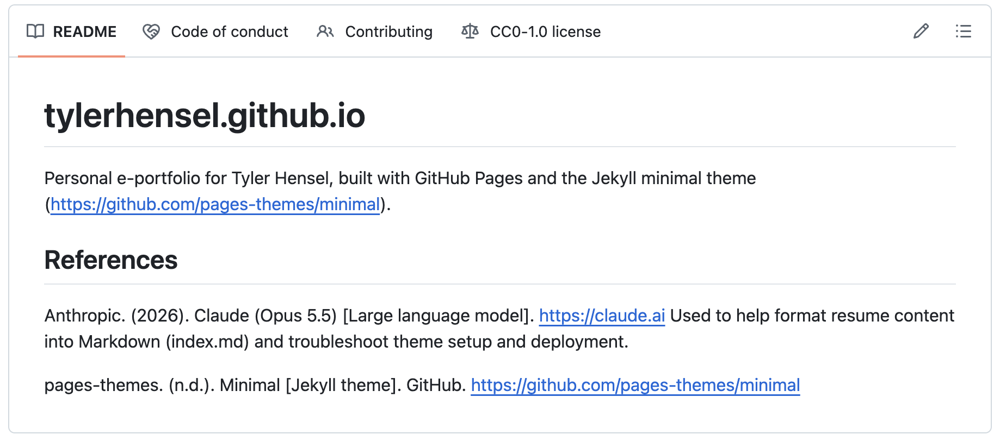
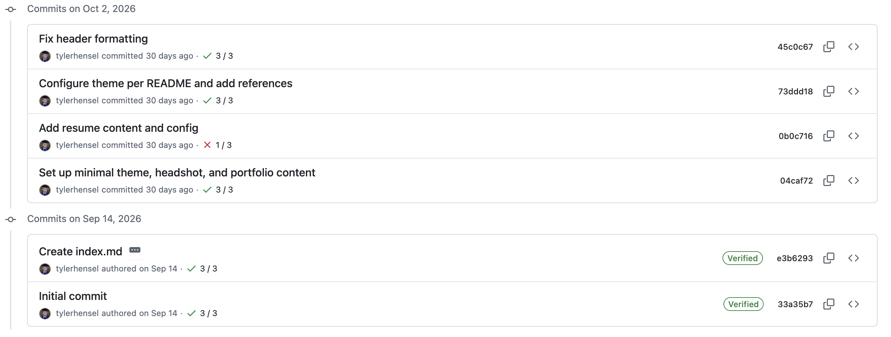

# How I Built This E-Portfolio with GitHub Pages

## Introduction

This e-portfolio is my professional website. It brings together my resume, education, experience, projects, and skills all in one place that I can share with future recruiters and employers. I built it for OM 620 (Tools and Technologies for Analytics) during my MSBA journey at CSUSM using **GitHub Pages**, **Jekyll**, and the **Minimal** theme, and I wrote all of the content in **Markdown** using **VS Code**. This is my first attempt at creating a website, and I'm pretty stoked about it.

Below are the steps I took to build it, from setting up the repo to getting the finished site live, so anyone can follow along and create their own!

---

## Step 1: Creating a GitHub Pages Repository

### Part 1: Creating the repository
I started by making a new repository on GitHub. The name was the important part because it had to be **tylerhensel.github.io**, or GitHub Pages wouldn't treat it as my personal site. I made it public and added a README so the repo wasn't empty.


### Part 2: Adding an index.md file
Next I needed a homepage. GitHub Pages looks for a file called `index.md` and uses it as the main page of the site. I made it right on GitHub with **Add file → Create new file**, then I named it `index.md`, and committed it.

### Part 3: Cloning the repository into VS Code
I cloned the repo to my computer and did the rest of my work in VS Code. I saved it in my OM 620 folder so all my class stuff is in one place. From there, I made changes, then committed and pushed them to GitHub.



---

## Step 2: GitHub Pages Goes Live

Because I named the repo tylerhensel.github.io, GitHub Pages published it automatically from the main branch, and my site went live at tylerhensel.github.io. You can see the live link and publishing settings under **Settings → Pages.**



---

## Step 3: Apply the Minimal Theme

At this point the site worked, but it only had GitHub's basic default look. To make it look more professional, I added the [Minimal theme](https://github.com/pages-themes/minimal), one of GitHub's official Jekyll themes.

### Part 1: Add the theme files
I copied the Minimal theme's files into my repo, like the `_layouts`, `_includes`, `_sass`, and `assets` folders. The main one is `_layouts/default.html`, which sets up how every page looks: a sidebar on the left with my name, photo, and description, and my content on the right.



### Part 2: Configure the theme in _config.yml
Then I followed the theme's README to set up `_config.yml`, which controls the settings for the whole site. These are the lines I changed:

```yaml
title: Tyler Hensel
description: "MSBA Candidate at CSUSM | Marketing · Sales · Analytics"
logo: /assets/img/logo.png
show_downloads: false
remote_theme: pages-themes/minimal@v0.2.0
plugins:
  - jekyll-remote-theme
```

- **title** and **description**: my name and tagline at the top of the sidebar
- **logo**: my headshot
- **show_downloads: false**: hides the "Download ZIP" buttons the theme adds by default
- **remote_theme** and **jekyll-remote-theme**: tell GitHub Pages to use the Minimal theme



### Part 3: Add my headshot
I saved my headshot as `logo.png` in the `assets/img` folder. Since `_config.yml` points to that file, my photo shows up in the sidebar on every page.


---

## Step 4: Add My Resume Content to index.md

Once the design was set, I added my resume to `index.md`. Every page needs these lines at the very top so Jekyll knows to use the theme:

```markdown
---
layout: default
---
```

I split my resume into sections with Markdown headers: **Summary**, **Education**, **Experience**, **Projects**, **Skills & Tools**, and **Certifications**. Here's the Markdown I used:

- **Headers** (`#`, `##`, `###`) for my name, sections, and jobs
- **Bold** for my school and key skills, and *italics* for dates and locations
- **Bullet lists** for job duties and skills
- **Numbered lists** for projects and certifications
- **Links** for my LinkedIn and email
- **A divider line** (`---`) under my header
- **Inline code** to highlight tools like `SQL` and `Python`

VS Code also has a [Markdown Preview](https://code.visualstudio.com/docs/languages/markdown#_markdown-preview) (**Cmd + K**, then **V**) that shows the Markdown and how it'll look side by side, which makes it easy to check formatting before pushing changes.



---

## Step 5: Update the README

I also cleaned up the repo's `README.md` so it explains what the project is, links to the Minimal theme, and lists my references. It's the first thing people see when they open the repo on GitHub, so I wanted it to make sense to anyone who clicks on it.



---

## Step 6: Commit, Push, and Check the Live Site

Whenever I finished a round of changes, I committed them with a short message about what I changed and pushed them to GitHub. GitHub Pages rebuilds the site automatically after each push, usually within a minute or two.

My commit history shows each stage of the build:

1. **Initial commit:** created the repository
2. **Create index.md:** added the main page
3. **Set up minimal theme, headshot, and portfolio content**
4. **Add resume content and config**
5. **Configure theme per README and add references**
6. **Fix header formatting**



---

## Helpful Resources

- [GitHub Pages](https://pages.github.com/): instructions for creating a GitHub Pages site
- [Adding a theme to your GitHub Pages site using Jekyll](https://docs.github.com/en/pages/setting-up-a-github-pages-site-with-jekyll/adding-a-theme-to-your-github-pages-site-using-jekyll): GitHub's guide to adding a Jekyll theme
- [Jekyll](https://jekyllrb.com/): the static site generator used by GitHub Pages
- [Minimal theme (pages-themes/minimal)](https://github.com/pages-themes/minimal): the theme template used for this site
- [VS Code Markdown Preview](https://code.visualstudio.com/docs/languages/markdown#_markdown-preview): viewing Markdown and its preview side by side

## References

Anthropic. (2026). Claude (Opus 5.5) [Large language model]. https://claude.ai

Used to help draft and format this guide in Markdown.

pages-themes. (n.d.). Minimal [Jekyll theme]. GitHub. https://github.com/pages-themes/minimal

---

## Final Result


Visit the live site: **[tylerhensel.github.io](https://tylerhensel.github.io)**
